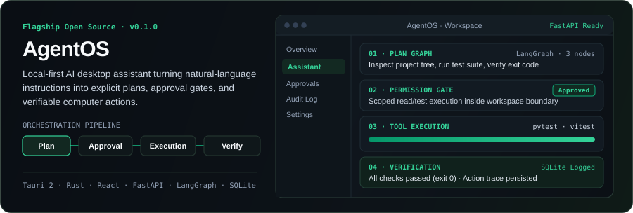
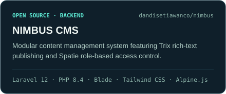
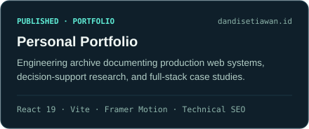

  <picture>
    <source media="(prefers-color-scheme: dark)" srcset="./assets/header.svg" />
    <source media="(prefers-color-scheme: light)" srcset="./assets/header-light.svg" />
    
  </picture>

  <a href="https://www.dandisetiawan.id/"><picture><source media="(prefers-color-scheme: dark)" srcset="./assets/nav/portfolio.svg" /><source media="(prefers-color-scheme: light)" srcset="./assets/nav/portfolio-light.svg" /></picture></a>&nbsp;&nbsp;<a href="https://www.ngoprekdigital.site/"><picture><source media="(prefers-color-scheme: dark)" srcset="./assets/nav/ngoprek.svg" /><source media="(prefers-color-scheme: light)" srcset="./assets/nav/ngoprek-light.svg" /></picture></a>&nbsp;&nbsp;<a href="https://linkedin.com/in/dandi-setiawan"><picture><source media="(prefers-color-scheme: dark)" srcset="./assets/nav/linkedin.svg" /><source media="(prefers-color-scheme: light)" srcset="./assets/nav/linkedin-light.svg" /></picture></a>&nbsp;&nbsp;<a href="mailto:dandisetiawan.co@gmail.com"><picture><source media="(prefers-color-scheme: dark)" srcset="./assets/nav/email.svg" /><source media="(prefers-color-scheme: light)" srcset="./assets/nav/email-light.svg" /></picture></a>&nbsp;&nbsp;<a href="https://wa.me/6287700616969"><picture><source media="(prefers-color-scheme: dark)" srcset="./assets/nav/whatsapp.svg" /><source media="(prefers-color-scheme: light)" srcset="./assets/nav/whatsapp-light.svg" /></picture></a>&nbsp;&nbsp;<a href="https://github.com/dandisetiawanco?tab=repositories"><picture><source media="(prefers-color-scheme: dark)" srcset="./assets/nav/repositories.svg" /><source media="(prefers-color-scheme: light)" srcset="./assets/nav/repositories-light.svg" /></picture></a>

---

## About

I am a software engineer and AI developer based in Bandar Lampung, Indonesia. My engineering work focuses on software architecture, full-stack web systems, local-first AI agents, and workflow automation built with Python, TypeScript, PHP, and Rust.

Alongside open-source and independent engineering work, I founded [NGOPREK DIGITAL](https://www.ngoprekdigital.site/), a collaborative studio where engineers and designers build custom web platforms, mobile applications, and applied AI tools. I hold a Bachelor of Computer Science (S.Kom.) in Informatics from Universitas Teknokrat Indonesia, where my research examined decision-support systems and language model information retrieval.

---

## Featured Projects

  <a href="https://github.com/dandisetiawanco/AgentOs"><picture><source media="(prefers-color-scheme: dark)" srcset="./assets/projects/agentos.svg" /><source media="(prefers-color-scheme: light)" srcset="./assets/projects/agentos-light.svg" /></picture></a>

  <a href="https://github.com/dandisetiawanco/nexapos"><picture><source media="(prefers-color-scheme: dark)" srcset="./assets/projects/nexapos.svg" /><source media="(prefers-color-scheme: light)" srcset="./assets/projects/nexapos-light.svg" /></picture></a>
  &nbsp;
  <a href="https://github.com/dandisetiawanco/nimbus"><picture><source media="(prefers-color-scheme: dark)" srcset="./assets/projects/nimbus.svg" /><source media="(prefers-color-scheme: light)" srcset="./assets/projects/nimbus-light.svg" /></picture></a>

  <a href="https://www.dandisetiawan.id/"><picture><source media="(prefers-color-scheme: dark)" srcset="./assets/projects/portfolio.svg" /><source media="(prefers-color-scheme: light)" srcset="./assets/projects/portfolio-light.svg" /></picture></a>
  &nbsp;
  <a href="https://www.ngoprekdigital.site/"><picture><source media="(prefers-color-scheme: dark)" srcset="./assets/projects/ngoprek-platform.svg" /><source media="(prefers-color-scheme: light)" srcset="./assets/projects/ngoprek-platform-light.svg" /></picture></a>

| Repository | Overview and Stack |
| :--- | :--- |
| **[Employee Management System](https://github.com/dandisetiawanco/dandisetiawan_pk)** | Employee CRUD service with JWT authentication, SQL audit-log triggers, and PDF report export `Laravel 13` `PHP` `MySQL` `JWT` `DomPDF` |
| **[AkademiaSupport](https://github.com/dandisetiawanco/akademiasupport)** · [Live](https://akademiasupport-ucil.vercel.app) | Web application for tracking academic assignments and coursework deadlines `React 19` `React Router` `Vite` |
| **[Vegetables & Fruits Interactive](https://github.com/dandisetiawanco/vegetables-fruits-interactive)** · [Live](https://vegetables-fruits-interactive.vercel.app) | Problem-based interactive English learning web app for elementary students `React 19` `Vite` `JavaScript` |

---

## Technical Stack

| Domain | Technologies |
| :--- | :--- |
| **Languages** | Python, TypeScript, JavaScript, PHP, Rust, SQL, HTML5, CSS3 |
| **AI & Automation** | LangGraph, LLM Agent Orchestration, Tool-Use Pipelines, Scikit-learn, Data Preprocessing, Information Retrieval |
| **Backend & APIs** | FastAPI, Laravel, Django, Node.js, REST APIs, Laravel Sanctum, JWT Authentication |
| **Frontend** | React, Next.js, Tailwind CSS, Vite, React Router, TanStack Query, Framer Motion, Alpine.js, Blade |
| **Desktop & Web** | Tauri 2, Local-First Desktop Runtimes, Responsive Mobile Web |
| **Databases** | PostgreSQL, MySQL, SQLite, Relational Schema Design, SQL Audit Triggers |
| **Infrastructure** | Docker, GitHub Actions, Vercel, Linux, Nginx |
| **Tooling** | Git, GitHub, uv, pnpm, Composer, Postman, Figma, VS Code |

---

## Activity & Metrics

  <picture>
    <source media="(prefers-color-scheme: dark)" srcset="./assets/analytics/stats.svg" />
    <source media="(prefers-color-scheme: light)" srcset="./assets/analytics/stats-light.svg" />
    
  </picture>
  &nbsp;
  <picture>
    <source media="(prefers-color-scheme: dark)" srcset="./assets/analytics/languages.svg" />
    <source media="(prefers-color-scheme: light)" srcset="./assets/analytics/languages-light.svg" />
    
  </picture>

  <picture>
    <source media="(prefers-color-scheme: dark)" srcset="./assets/analytics/activity.svg" />
    <source media="(prefers-color-scheme: light)" srcset="./assets/analytics/activity-light.svg" />
    
  </picture>

  Metrics cover public GitHub activity across owned non-fork repositories over the trailing 52 weeks and update automatically via GitHub Actions. Private repository contributions are excluded from public totals.

---

  <picture>
    <source media="(prefers-color-scheme: dark)" srcset="./assets/footer.svg" />
    <source media="(prefers-color-scheme: light)" srcset="./assets/footer-light.svg" />
    
  </picture>

