

  <picture>
    <source media="(prefers-color-scheme: dark)" srcset="./assets/hero/hero-dark.svg" />
    <source media="(prefers-color-scheme: light)" srcset="./assets/hero/hero-light.svg" />
    
  </picture>

## Engineering Identity

I am a Full-Stack Developer and AI Engineer based in Bandar Lampung, Indonesia, designing production web applications, local-first AI agent runtimes, backend services, and cross-platform desktop software. My engineering focus sits at the intersection of software architecture, applied artificial intelligence, and automated execution systems across Python, TypeScript, Rust, Go, Java, and PHP.

I hold a Bachelor of Computer Science (S.Kom.) in Informatics from Universitas Teknokrat Indonesia, with research centered on decision-support systems and language model information retrieval. Alongside my independent engineering work, I collaborate on custom web platforms and applied AI builds through [NGOPREK DIGITAL](https://www.ngoprekdigital.site/).

| Practice Area | Engineering Focus |
| :--- | :--- |
| Full-Stack Engineering | End-to-end web architectures across React, Next.js, TypeScript, Laravel, Django, FastAPI, and Spring Boot |
| AI Agents & Automation | Typed planning graphs, permission-gated tool execution, local Ollama and cloud model orchestration |
| Backend & Data Architecture | ACID financial ledgers, RBAC systems, observability pipelines, and relational modeling in PostgreSQL, MySQL, and SQLite |
| Desktop Systems | Native Tauri 2 and Rust desktop hosts paired with authenticated loopback IPC sidecar runtimes |

## Selected Engineering Projects

<!-- DYNAMIC:FEATURED_PROJECTS:START -->

  <a href="https://github.com/dandisetiawanco/AgentOs"><picture><source media="(prefers-color-scheme: dark)" srcset="./assets/projects/agentos-dark.svg" /><source media="(prefers-color-scheme: light)" srcset="./assets/projects/agentos-light.svg" />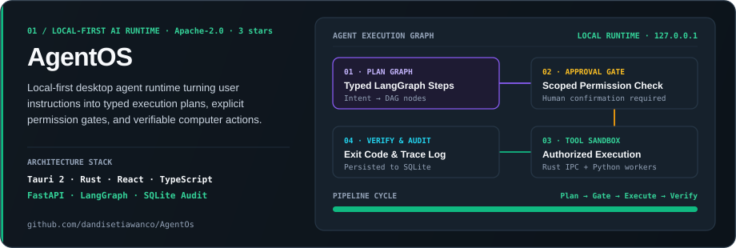</picture></a>

  <a href="https://github.com/dandisetiawanco/AgentOs"><strong>AgentOS</strong></a> · v0.1.0 Preview · Apache-2.0 · 3 stars · Updated 2026-11-23 
  Open-source local-first desktop agent that compiles natural-language tasks into typed execution plans, explicit approval gates, sandboxed tool runs, and SQLite audit traces. 
  <code>Tauri 2</code> <code>Rust</code> <code>React</code> <code>TypeScript</code> <code>FastAPI</code> <code>LangGraph</code> <code>SQLite</code>

  <a href="https://github.com/dandisetiawanco/Omnidesk"><picture><source media="(prefers-color-scheme: dark)" srcset="./assets/projects/omnidesk-dark.svg" /><source media="(prefers-color-scheme: light)" srcset="./assets/projects/omnidesk-light.svg" /></picture></a>

  <a href="https://github.com/dandisetiawanco/Omnidesk"><strong>OmniDesk</strong></a> · v0.1.0 Preview · 1 star · Updated 2026-11-24 
  Cross-platform desktop AI operator bridging local Ollama and cloud model providers over authenticated loopback IPC with native adapters for macOS, Linux, and Windows. 
  <code>Rust</code> <code>Tauri 2</code> <code>Python</code> <code>React 19</code> <code>TypeScript</code> <code>Ollama</code> <code>Loopback IPC</code>

<table>
  <tr>
    <td valign="top" width="50%">
      <a href="https://github.com/dandisetiawanco/Ledger"><picture><source media="(prefers-color-scheme: dark)" srcset="./assets/projects/ledger-dark.svg" /><source media="(prefers-color-scheme: light)" srcset="./assets/projects/ledger-light.svg" />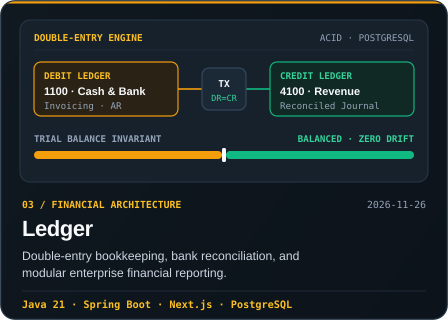</picture></a>  
      <a href="https://github.com/dandisetiawanco/Ledger"><strong>Ledger</strong></a> · Active · Updated 2026-11-26 
  Modular double-entry accounting and financial management platform built with explicit ACID transaction boundaries, invoicing, bank reconciliation, and trial balance reporting. 
  <code>Java 21</code> <code>Spring Boot</code> <code>Next.js</code> <code>TypeScript</code> <code>PostgreSQL</code> <code>Docker</code>
    </td>
    <td valign="top" width="50%">
      <a href="https://github.com/dandisetiawanco/TalentOS"><picture><source media="(prefers-color-scheme: dark)" srcset="./assets/projects/talentos-dark.svg" /><source media="(prefers-color-scheme: light)" srcset="./assets/projects/talentos-light.svg" />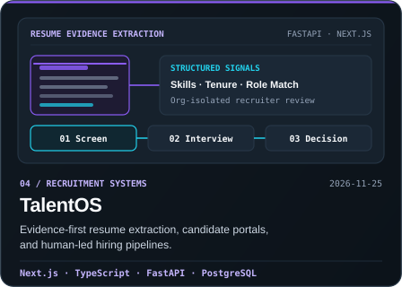</picture></a>  
      <a href="https://github.com/dandisetiawanco/TalentOS"><strong>TalentOS</strong></a> · Active · Updated 2026-11-25 
  Full-stack recruitment operating system uniting evidence-first resume extraction, organization-isolated hiring workspaces, and structured human-led evaluation pipelines. 
  <code>Next.js</code> <code>TypeScript</code> <code>FastAPI</code> <code>Python</code> <code>PostgreSQL</code> <code>Docker</code>
    </td>
  </tr>
</table>

  <a href="https://github.com/dandisetiawanco/InfraOS"><picture><source media="(prefers-color-scheme: dark)" srcset="./assets/projects/infraos-dark.svg" /><source media="(prefers-color-scheme: light)" srcset="./assets/projects/infraos-light.svg" /></picture></a>

  <a href="https://github.com/dandisetiawanco/InfraOS"><strong>InfraOS</strong></a> · Active · Updated 2026-11-25 
  Infrastructure operations control plane combining Go telemetry collectors, Prometheus metrics, Terraform provisioning modules, and controlled deployment workflows. 
  <code>Go</code> <code>Next.js</code> <code>TypeScript</code> <code>PostgreSQL</code> <code>Prometheus</code> <code>Terraform</code> <code>Docker</code>

  
<strong>Additional Verified Public Repositories</strong>

  

    <a href="https://github.com/dandisetiawanco/nexapos"><strong>NEXA POS</strong></a>: Point-of-sale register, barcode SKU lookup, and Sanctum role-gated inventory system. · <code>Laravel 12</code> <code>PHP</code> <code>React</code> <code>MySQL</code> 
    <a href="https://github.com/dandisetiawanco/nimbus"><strong>NIMBUS CMS</strong></a>: Modular publishing platform with Trix rich-text workflows and Spatie RBAC governance. · <code>Laravel 12</code> <code>PHP 8.4</code> <code>Blade</code> <code>MySQL</code> 
    <a href="https://github.com/dandisetiawanco/dandisetiawan_pk"><strong>Employee Management System</strong></a>: JWT-authenticated employee CRUD API with SQL audit triggers and automated PDF reporting. · <code>Laravel</code> <code>PHP</code> <code>MySQL</code> <code>JWT</code> 
    <a href="https://github.com/dandisetiawanco/vegetables-fruits-interactive"><strong>Vegetables &amp; Fruits Interactive</strong></a> · <a href="https://vegetables-fruits-interactive.vercel.app">Live</a>: Problem-based interactive English learning web application built for elementary classrooms. · <code>React</code> <code>Vite</code> <code>JavaScript</code>
  

<!-- DYNAMIC:FEATURED_PROJECTS:END -->

## Recently Shipped

<!-- DYNAMIC:RECENTLY_SHIPPED:START -->

  <picture>
    <source media="(prefers-color-scheme: dark)" srcset="./assets/analytics/recent-pulse-dark.svg" />
    <source media="(prefers-color-scheme: light)" srcset="./assets/analytics/recent-pulse-light.svg" />
    
  </picture>

| Repository | Summary | Language | Latest Activity | Updated |
| :--- | :--- | :--- | :--- | :--- |
| [**aurel-social**](https://github.com/dandisetiawanco/aurel-social) | A premium AI-powered social super app concept unifying private messaging, social networking... | `Multi` | [`b825079`](https://github.com/dandisetiawanco/aurel-social/commit/b825079d117b53f905b5ad0794ab2109cc837f4f) docs: add product architecture and design system... | `2026-11-27` |
| [**nexus-workflow-studio**](https://github.com/dandisetiawanco/nexus-workflow-studio) | A premium visual workflow studio concept for AI agent orchestration, conditional automation... | `Multi` | [`192be94`](https://github.com/dandisetiawanco/nexus-workflow-studio/commit/192be9480b6ce926a69036e8bd8753aca98b2221) feat: publish NEXUS workflow studio design and... | `2026-11-27` |
| [**nova-finance**](https://github.com/dandisetiawanco/nova-finance) | A premium personal finance mobile app concept featuring an editable FigCraft design... | `Multi` | [`20762f1`](https://github.com/dandisetiawanco/nova-finance/commit/20762f119e2c276c3151e8995acd9d612e2ca428) feat: publish NOVA Finance product design and... | `2026-11-27` |
| [**Ledger**](https://github.com/dandisetiawanco/Ledger) | A financial management and accounting platform built with Java, Spring Boot, and Next.js... | `Java` | [`229134d`](https://github.com/dandisetiawanco/Ledger/commit/229134df402c6b66149b60f1828be2082747b245) docs: record verified CI pass in implementation... | `2026-11-26` |
| [**InfraOS**](https://github.com/dandisetiawanco/InfraOS) | An infrastructure operations platform built with Go and Next.js, featuring real-time system... | `Go` | [`7640c26`](https://github.com/dandisetiawanco/InfraOS/commit/7640c2629e871ce4dfecde5508faf6ab269f0a78) fix(ci): declare hcloud provider in compute... | `2026-11-25` |
| [**TalentOS**](https://github.com/dandisetiawanco/TalentOS) | A modern recruitment operating system featuring Liquid Glass interfaces, intelligent resume... | `TypeScript` | [`6021f22`](https://github.com/dandisetiawanco/TalentOS/commit/6021f22238f3553aa6c0ec3e1653ca84b5f98d19) docs: finalize portfolio README, branding icons... | `2026-11-25` |
<!-- DYNAMIC:RECENTLY_SHIPPED:END -->

## Engineering Ecosystem

  <picture>
    <source media="(prefers-color-scheme: dark)" srcset="./assets/ecosystem/stack-architecture-dark.svg" />
    <source media="(prefers-color-scheme: light)" srcset="./assets/ecosystem/stack-architecture-light.svg" />
    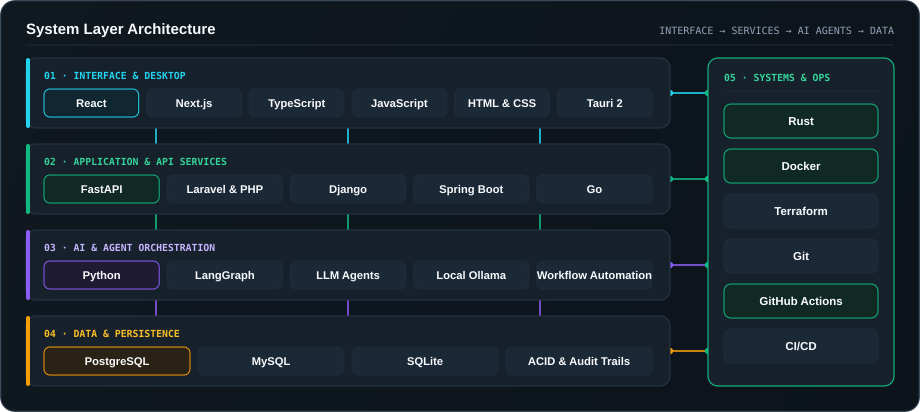
  </picture>

## AI Systems & Automation

Applied AI software breaks down when model outputs trigger unverified side effects. Across [AgentOS](https://github.com/dandisetiawanco/AgentOs), [OmniDesk](https://github.com/dandisetiawanco/Omnidesk), and [TalentOS](https://github.com/dandisetiawanco/TalentOS), I structure autonomous workflows around five explicit engineering invariants: structured intent parsing, typed LangGraph plans, human approval gates before privileged actions, loopback-isolated execution boundaries, and verifiable audit logs persisted to relational storage.

  <picture>
    <source media="(prefers-color-scheme: dark)" srcset="./assets/ecosystem/ai-pipeline-dark.svg" />
    <source media="(prefers-color-scheme: light)" srcset="./assets/ecosystem/ai-pipeline-light.svg" />
    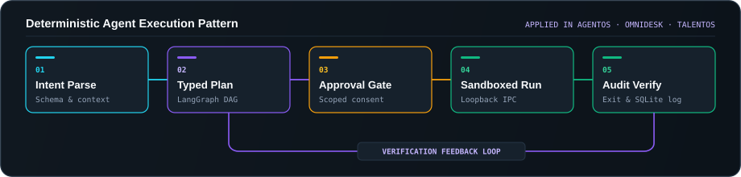
  </picture>

## Engineering Activity & Analytics

  <picture>
    <source media="(prefers-color-scheme: dark)" srcset="./assets/analytics/overview-dark.svg" />
    <source media="(prefers-color-scheme: light)" srcset="./assets/analytics/overview-light.svg" />
    
  </picture>

  <picture>
    <source media="(prefers-color-scheme: dark)" srcset="./assets/analytics/velocity-dark.svg" />
    <source media="(prefers-color-scheme: light)" srcset="./assets/analytics/velocity-light.svg" />
    
  </picture>

## Contribution Visualization

  <picture>
    <source media="(prefers-color-scheme: dark)" srcset="./assets/analytics/heatmap-dark.svg" />
    <source media="(prefers-color-scheme: light)" srcset="./assets/analytics/heatmap-light.svg" />
    
  </picture>

<!-- DYNAMIC:ANALYTICS_FOOTER:START -->
Scope: public GitHub data across 14 owned non-fork repositories (150 trailing 52-week public contributions, 85 public commits, 4 stars). Private repository data is excluded. Last verified sync: <code>2026-11-28 03:19 UTC</code>.
<!-- DYNAMIC:ANALYTICS_FOOTER:END -->

## Contact & Links

| Channel | Destination |
| :--- | :--- |
| Portfolio | [dandisetiawan.id](https://www.dandisetiawan.id/) |
| GitHub | [github.com/dandisetiawanco](https://github.com/dandisetiawanco) |
| Studio Context | [ngoprekdigital.site](https://www.ngoprekdigital.site/) |
| LinkedIn | [linkedin.com/in/dandi-setiawan](https://linkedin.com/in/dandi-setiawan) |
| Email | [dandisetiawan.co@gmail.com](mailto:dandisetiawan.co@gmail.com) |

 

  <picture>
    <source media="(prefers-color-scheme: dark)" srcset="./assets/footer/signature-dark.svg" />
    <source media="(prefers-color-scheme: light)" srcset="./assets/footer/signature-light.svg" />
    
  </picture>

