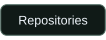
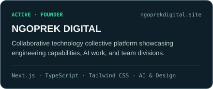
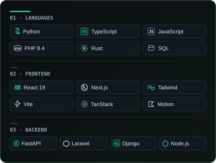
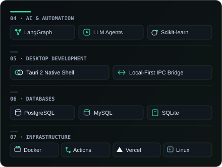
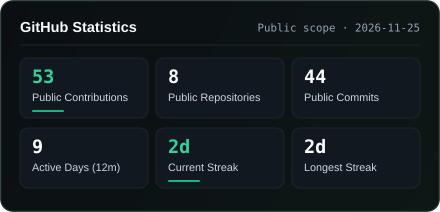

  <picture>
    <source media="(prefers-color-scheme: dark)" srcset="./assets/header.svg" />
    <source media="(prefers-color-scheme: light)" srcset="./assets/header-light.svg" />
    
  </picture>

  <a href="https://www.dandisetiawan.id/"><picture><source media="(prefers-color-scheme: dark)" srcset="./assets/nav/portfolio.svg" /><source media="(prefers-color-scheme: light)" srcset="./assets/nav/portfolio-light.svg" /></picture></a><a href="https://www.ngoprekdigital.site/"><picture><source media="(prefers-color-scheme: dark)" srcset="./assets/nav/ngoprek.svg" /><source media="(prefers-color-scheme: light)" srcset="./assets/nav/ngoprek-light.svg" /></picture></a><a href="https://linkedin.com/in/dandi-setiawan"><picture><source media="(prefers-color-scheme: dark)" srcset="./assets/nav/linkedin.svg" /><source media="(prefers-color-scheme: light)" srcset="./assets/nav/linkedin-light.svg" /></picture></a><a href="mailto:dandisetiawan.co@gmail.com"><picture><source media="(prefers-color-scheme: dark)" srcset="./assets/nav/email.svg" /><source media="(prefers-color-scheme: light)" srcset="./assets/nav/email-light.svg" /></picture></a><a href="https://wa.me/6287700616969"><picture><source media="(prefers-color-scheme: dark)" srcset="./assets/nav/whatsapp.svg" /><source media="(prefers-color-scheme: light)" srcset="./assets/nav/whatsapp-light.svg" /></picture></a><a href="https://github.com/dandisetiawanco?tab=repositories"><picture><source media="(prefers-color-scheme: dark)" srcset="./assets/nav/repositories.svg" /><source media="(prefers-color-scheme: light)" srcset="./assets/nav/repositories-light.svg" /></picture></a>

## About

Software engineer and AI developer based in Bandar Lampung, Indonesia, building full-stack web applications, local-first AI agent runtimes, and workflow automation with Python, TypeScript, PHP, and Rust. I hold a Bachelor of Computer Science (S.Kom.) in Informatics from Universitas Teknokrat Indonesia, where my research focused on decision-support systems and language model information retrieval, and I founded [NGOPREK DIGITAL](https://www.ngoprekdigital.site/) as a collaborative studio for custom web and applied AI projects.

## Selected Work

  <a href="https://github.com/dandisetiawanco/AgentOs"><picture><source media="(prefers-color-scheme: dark)" srcset="./assets/projects/agentos.svg" /><source media="(prefers-color-scheme: light)" srcset="./assets/projects/agentos-light.svg" /></picture></a>

  <a href="https://github.com/dandisetiawanco/nexapos"><picture><source media="(prefers-color-scheme: dark)" srcset="./assets/projects/nexapos.svg" /><source media="(prefers-color-scheme: light)" srcset="./assets/projects/nexapos-light.svg" /></picture></a>
  &nbsp;
  <a href="https://github.com/dandisetiawanco/nimbus"><picture><source media="(prefers-color-scheme: dark)" srcset="./assets/projects/nimbus.svg" /><source media="(prefers-color-scheme: light)" srcset="./assets/projects/nimbus-light.svg" /></picture></a>

  <a href="https://www.dandisetiawan.id/"><picture><source media="(prefers-color-scheme: dark)" srcset="./assets/projects/portfolio.svg" /><source media="(prefers-color-scheme: light)" srcset="./assets/projects/portfolio-light.svg" /></picture></a>
  &nbsp;
  <a href="https://www.ngoprekdigital.site/"><picture><source media="(prefers-color-scheme: dark)" srcset="./assets/projects/ngoprek-platform.svg" /><source media="(prefers-color-scheme: light)" srcset="./assets/projects/ngoprek-platform-light.svg" /></picture></a>

  <strong>Additional Open-Source Repositories</strong> 
  
    <a href="https://github.com/dandisetiawanco/dandisetiawan_pk"><strong>Employee Management System</strong></a>: JWT-authenticated employee CRUD API with SQL audit triggers and DomPDF reports · <code>Laravel 13</code> <code>PHP</code> <code>MySQL</code> 
    <a href="https://github.com/dandisetiawanco/akademiasupport"><strong>AkademiaSupport</strong></a> · <a href="https://akademiasupport-ucil.vercel.app">Live</a>: Academic assignment and coursework deadline tracker · <code>React 19</code> <code>React Router</code> <code>Vite</code> 
    <a href="https://github.com/dandisetiawanco/vegetables-fruits-interactive"><strong>Vegetables &amp; Fruits Interactive</strong></a> · <a href="https://vegetables-fruits-interactive.vercel.app">Live</a>: Problem-based interactive English learning web app for elementary students · <code>React 19</code> <code>Vite</code> <code>JavaScript</code>
  

## Engineering Stack

  <picture>
    <source media="(prefers-color-scheme: dark)" srcset="./assets/stack-core.svg" />
    <source media="(prefers-color-scheme: light)" srcset="./assets/stack-core-light.svg" />
    
  </picture>
  &nbsp;
  <picture>
    <source media="(prefers-color-scheme: dark)" srcset="./assets/stack-systems.svg" />
    <source media="(prefers-color-scheme: light)" srcset="./assets/stack-systems-light.svg" />
    
  </picture>

## Activity & Metrics

  <picture>
    <source media="(prefers-color-scheme: dark)" srcset="./assets/analytics/stats.svg" />
    <source media="(prefers-color-scheme: light)" srcset="./assets/analytics/stats-light.svg" />
    
  </picture>
  &nbsp;
  <picture>
    <source media="(prefers-color-scheme: dark)" srcset="./assets/analytics/languages.svg" />
    <source media="(prefers-color-scheme: light)" srcset="./assets/analytics/languages-light.svg" />
    
  </picture>

  <picture>
    <source media="(prefers-color-scheme: dark)" srcset="./assets/analytics/activity.svg" />
    <source media="(prefers-color-scheme: light)" srcset="./assets/analytics/activity-light.svg" />
    
  </picture>

  Metrics reflect public GitHub activity across owned non-fork repositories over the trailing 52 weeks and refresh automatically via GitHub Actions. Private repository contributions are excluded from public totals.

  <picture>
    <source media="(prefers-color-scheme: dark)" srcset="./assets/footer.svg" />
    <source media="(prefers-color-scheme: light)" srcset="./assets/footer-light.svg" />
    
  </picture>

