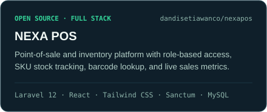
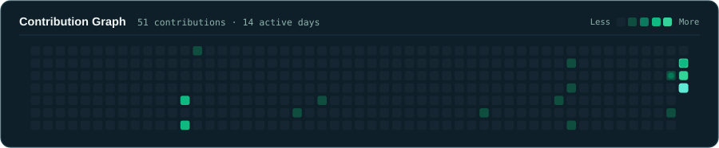
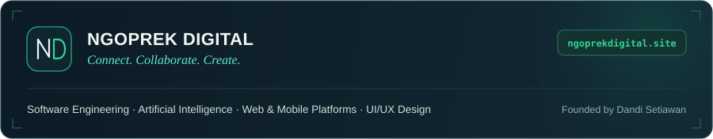

  <picture>
    <source media="(prefers-color-scheme: dark)" srcset="./assets/header.svg" />
    <source media="(prefers-color-scheme: light)" srcset="./assets/header-light.svg" />
    
  </picture>

  <picture>
    <source media="(prefers-color-scheme: dark)" srcset="./assets/typing.svg" />
    <source media="(prefers-color-scheme: light)" srcset="./assets/typing-light.svg" />
    
  </picture>

  <a href="https://www.dandisetiawan.id/"><strong>Portfolio</strong></a>
  &nbsp;&nbsp;·&nbsp;&nbsp;
  <a href="https://www.ngoprekdigital.site/"><strong>NGOPREK DIGITAL</strong></a>
  &nbsp;&nbsp;·&nbsp;&nbsp;
  <a href="https://linkedin.com/in/dandi-setiawan"><strong>LinkedIn</strong></a>
  &nbsp;&nbsp;·&nbsp;&nbsp;
  <a href="mailto:dandisetiawan.co@gmail.com"><strong>Email</strong></a>
  &nbsp;&nbsp;·&nbsp;&nbsp;
  <a href="https://wa.me/6287700616969"><strong>WhatsApp</strong></a>
  &nbsp;&nbsp;·&nbsp;&nbsp;
  <a href="https://github.com/dandisetiawanco?tab=repositories"><strong>Repositories</strong></a>

---

## About Me

I am a Full Stack Software Engineer and AI Developer based in Bandar Lampung, Indonesia, and the Founder of [NGOPREK DIGITAL](https://www.ngoprekdigital.site/). I hold a Bachelor of Computer Science (S.Kom.) in Informatics from Universitas Teknokrat Indonesia, where my research focused on decision support systems and language model information retrieval.

My engineering work centers on full-stack web platforms built with Laravel, React, Next.js, and FastAPI, alongside local-first AI agents and cross-platform desktop software with explicit permission boundaries and verifiable execution.

| Profile | Details |
| :--- | :--- |
| **Role** | Full Stack Software Engineer, AI Developer, Founder of NGOPREK DIGITAL |
| **Location** | Bandar Lampung, Indonesia |
| **Primary Focus** | Full-stack web systems, AI agent orchestration, desktop applications, and technical SEO |
| **Collaboration** | Open to software engineering roles, technical partnerships, and digital product engagements |

---

## Featured Projects

  <a href="https://github.com/dandisetiawanco/AgentOs">
    <picture>
      <source media="(prefers-color-scheme: dark)" srcset="./assets/projects/agentos.svg" />
      <source media="(prefers-color-scheme: light)" srcset="./assets/projects/agentos-light.svg" />
      
    </picture>
  </a>

  <a href="https://www.ngoprekdigital.site/">
    <picture>
      <source media="(prefers-color-scheme: dark)" srcset="./assets/projects/ngoprek-platform.svg" />
      <source media="(prefers-color-scheme: light)" srcset="./assets/projects/ngoprek-platform-light.svg" />
      
    </picture>
  </a>
  &nbsp;
  <a href="https://www.dandisetiawan.id/">
    <picture>
      <source media="(prefers-color-scheme: dark)" srcset="./assets/projects/portfolio.svg" />
      <source media="(prefers-color-scheme: light)" srcset="./assets/projects/portfolio-light.svg" />
      
    </picture>
  </a>

  <a href="https://github.com/dandisetiawanco/nexapos">
    <picture>
      <source media="(prefers-color-scheme: dark)" srcset="./assets/projects/nexapos.svg" />
      <source media="(prefers-color-scheme: light)" srcset="./assets/projects/nexapos-light.svg" />
      
    </picture>
  </a>
  &nbsp;
  <a href="https://github.com/dandisetiawanco/nimbus">
    <picture>
      <source media="(prefers-color-scheme: dark)" srcset="./assets/projects/nimbus.svg" />
      <source media="(prefers-color-scheme: light)" srcset="./assets/projects/nimbus-light.svg" />
      
    </picture>
  </a>

### Additional Public Repositories

| Project | Overview and Stack |
| :--- | :--- |
| **[Employee Management System](https://github.com/dandisetiawanco/dandisetiawan_pk)** | RESTful employee CRUD platform with JWT authentication, SQL audit-log triggers, and PDF report export (`Laravel 13`, `PHP`, `MySQL`, `JWT`, `DomPDF`) |
| **[AkademiaSupport](https://github.com/dandisetiawanco/akademiasupport)** · [Live](https://akademiasupport-ucil.vercel.app) | Web-based academic assignment management application (`React 19`, `React Router`, `Vite`) |
| **[Vegetables & Fruits Interactive](https://github.com/dandisetiawanco/vegetables-fruits-interactive)** · [Live](https://vegetables-fruits-interactive.vercel.app) | Interactive Problem-Based Learning English app for elementary students (`React 19`, `Vite`, `JavaScript`) |

Browse all public work on [GitHub Repositories](https://github.com/dandisetiawanco?tab=repositories) or review additional client case studies on [dandisetiawan.id](https://www.dandisetiawan.id/).

---

## Technical Stack

| Category | Technologies |
| :--- | :--- |
|  &nbsp;**Programming Languages** | JavaScript, TypeScript, Python, PHP, Rust, SQL, HTML5, CSS3 |
|  &nbsp;**Frontend Engineering** | React, Next.js, Tailwind CSS, Vite, React Router, TanStack Query, Framer Motion, Alpine.js, Blade |
|  &nbsp;**Backend Engineering** | Laravel, FastAPI, Django, Node.js, REST APIs, Laravel Sanctum, JWT Authentication |
|  &nbsp;**Artificial Intelligence** | LangGraph, LLM Agent Workflows, Machine Learning, Scikit-learn, Data Preprocessing, Information Retrieval |
|  &nbsp;**Database Systems** | MySQL, PostgreSQL, SQLite, Relational Schema Design, SQL Audit Triggers |
|  &nbsp;**Mobile and Desktop Development** | Tauri 2, Cross-Platform Desktop Architecture, Responsive Mobile Web |
|  &nbsp;**Infrastructure and DevOps** | Docker, GitHub Actions, Vercel, Linux, Nginx |
|  &nbsp;**Development Tools** | Git, GitHub, Composer, pnpm, uv, Postman, Figma, VS Code |

---

## GitHub Statistics

  <picture>
    <source media="(prefers-color-scheme: dark)" srcset="./assets/analytics/stats.svg" />
    <source media="(prefers-color-scheme: light)" srcset="./assets/analytics/stats-light.svg" />
    
  </picture>
  &nbsp;
  <picture>
    <source media="(prefers-color-scheme: dark)" srcset="./assets/analytics/languages.svg" />
    <source media="(prefers-color-scheme: light)" srcset="./assets/analytics/languages-light.svg" />
    
  </picture>

## Contribution Activity

  <picture>
    <source media="(prefers-color-scheme: dark)" srcset="./assets/analytics/activity.svg" />
    <source media="(prefers-color-scheme: light)" srcset="./assets/analytics/activity-light.svg" />
    
  </picture>

  <picture>
    <source media="(prefers-color-scheme: dark)" srcset="./assets/analytics/snake.svg" />
    <source media="(prefers-color-scheme: light)" srcset="./assets/analytics/snake-light.svg" />
    
  </picture>

---

## NGOPREK DIGITAL

  <a href="https://www.ngoprekdigital.site/">
    <picture>
      <source media="(prefers-color-scheme: dark)" srcset="./assets/ngoprek-digital.svg" />
      <source media="(prefers-color-scheme: light)" srcset="./assets/ngoprek-digital-light.svg" />
      
    </picture>
  </a>

[NGOPREK DIGITAL](https://www.ngoprekdigital.site/) is a multidisciplinary Indonesian technology collective I founded to unite software engineers, AI practitioners, product designers, and creative technologists. The collective builds web platforms, custom software, mobile applications, and applied AI solutions for organizations and independent teams.

---

## Professional Contact

| Channel | Destination |
| :--- | :--- |
| **Personal Website** | [dandisetiawan.id](https://www.dandisetiawan.id/) |
| **NGOPREK DIGITAL** | [ngoprekdigital.site](https://www.ngoprekdigital.site/) |
| **LinkedIn** | [linkedin.com/in/dandi-setiawan](https://linkedin.com/in/dandi-setiawan) |
| **Email** | [dandisetiawan.co@gmail.com](mailto:dandisetiawan.co@gmail.com) |
| **WhatsApp** | [+62 877-0061-6969](https://wa.me/6287700616969) |
| **Location** | Bandar Lampung, Indonesia |

---

  <picture>
    <source media="(prefers-color-scheme: dark)" srcset="./assets/footer.svg" />
    <source media="(prefers-color-scheme: light)" srcset="./assets/footer-light.svg" />
    
  </picture>

